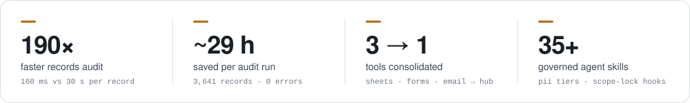
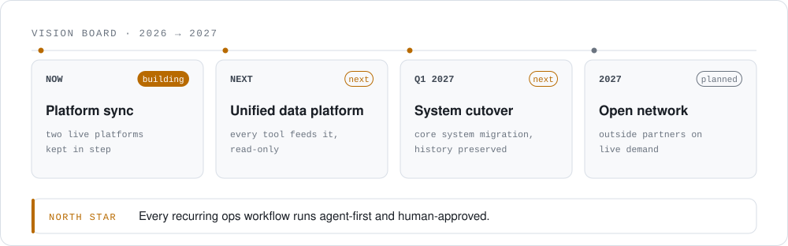

<picture>
  <source media="(prefers-color-scheme: dark)" srcset="./assets/header-dark.svg">
  <source media="(prefers-color-scheme: light)" srcset="./assets/header-light.svg">
  
</picture>

<br>

<!--NOW:START-->
```console
$ agent status
building    Platform sync
shipping    Operations modules
next        Unified data platform
countdown   System cutover in 81 days
refreshed   2026-11-19 21:10 UTC
```
<!--NOW:END-->

### Accomplished work

| | Project | What it does | Status |
|:-:|---|---|---|
| **01** | **Operations platform** | One system that retired shared spreadsheets, forms and email chains. | Live |
| **02** | **Eligibility engine** | Reads the documents, a fixed rulebook decides, every verdict is logged. | Live |
| **03** | **Vendor platform** | Multi-tenant marketplace where outside firms and in-house teams compete to fill live demand. | Live · testing |
| **04** | **Workforce platform** | Tracks every worker after they start: where they are, what is cleared, what is approved. | Live · testing |
| **05** | **Records audit** | 3,641 records checked at 160 ms each instead of 30 s, zero errors. | Complete |
| **06** | **Data platform** | Read-only feeds from every business system into one source of truth. | Building · near launch |
| **07** | **Market intelligence** | Turns an event, a company or a lead into a ready campaign list. | In development |

### Victories

<picture>
  <source media="(prefers-color-scheme: dark)" srcset="./assets/stats-dark.svg">
  <source media="(prefers-color-scheme: light)" srcset="./assets/stats-light.svg">
  
</picture>

### Stack

| Layer | Tools |
|---|---|
| **Languages** | `Python` `TypeScript` `SQL` |
| **Cloud + AI** | `Azure` `GitHub Actions` `Claude` `OpenAI` |

### How I build

- **Read-only first.** Nothing writes to a source system until the read path is proven.
- **Secrets stay in the vault.** Never in code, prompts or logs.
- **Every agent run is gated.** Classified, PII-checked, and verified against a sample before it ships.
- **Humans approve, agents grind.** Automation takes the repetitive work, people keep the decisions.

### Vision board

<picture>
  <source media="(prefers-color-scheme: dark)" srcset="./assets/vision-dark.svg">
  <source media="(prefers-color-scheme: light)" srcset="./assets/vision-light.svg">
  
</picture>

---

<sub>Open to conversations on agent architecture, data platforms and ops automation · <a href="https://www.linkedin.com/in/jose-yamas">in/jose-yamas</a></sub>
